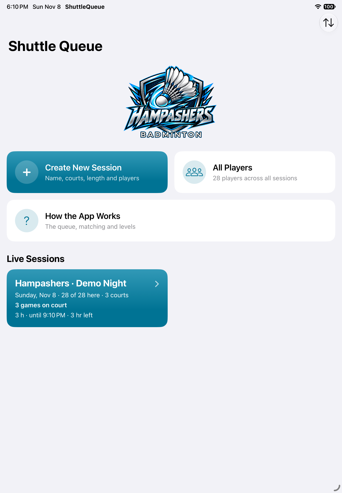
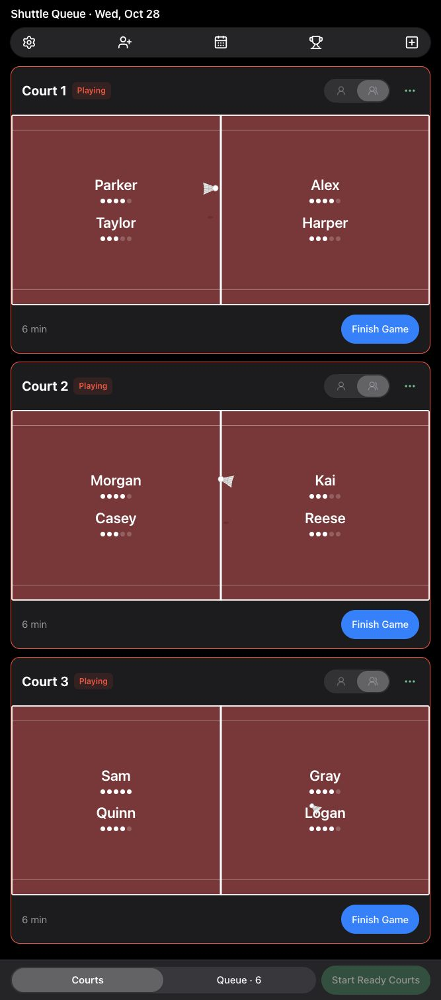
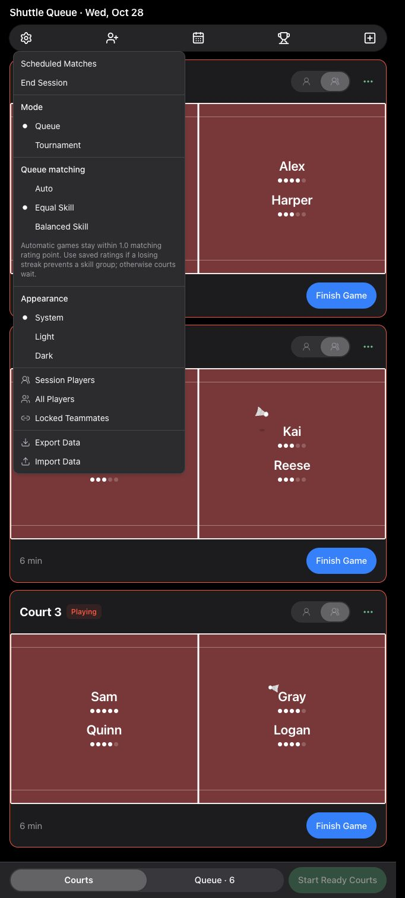

# Shuttle Queue 🏸

Run a badminton club night without juggling a paper queue. Shuttle Queue manages courts, player turns, balanced matches, ratings, and tournaments on iPad and the web.

[Open the web app](https://hampashers.netlify.app) · [Native iPad source](https://github.com/blueratdota/badminton-queue-app) · [Full playing rules](RULES.md) · [MIT license](LICENSE)

## Screenshots

Actual app screens using a fictional demo roster. The web app adapts to phones and tablets; the native app is designed for iPad.

| Native iPad app | Web courts | Queue matching settings |
| --- | --- | --- |
|  |  |  |

## Features

- **Multiple courts:** run singles and doubles together, start ready courts, and see each court's next game without booking a player twice.
- **Fair player rotation:** counted games and rest order guide selection, with support for arrivals, sitting out, returning players, and organiser adjustments.
- **Three matching modes:** choose Auto, Equal Skill, or Balanced Skill for each session; copied sessions retain their setting.
- **Control when you need it:** shuffle a lineup, keep one side, replace a player, select a manual lineup, or lock regular teammates together.
- **Scheduled matches:** reserve exact teams after their first game, with court assignment, postponement, cancellation, and queue-priority protections.
- **Ratings and standings:** Elo-style rating changes, display-only win/loss streak emojis, match history, result corrections, and standings.
- **Tournament play:** round robin followed by a double-elimination bracket, for singles or doubles.
- **Session management:** create, end, reopen, and revisit sessions; maintain a player registry across nights.
- **Local data:** the iPad saves on-device; the hosted web app saves in the current browser and supports JSON export/import.
- **Adaptive interface:** phone navigation, tablet layouts, light/dark appearance, and court rally animations that respect Reduce Motion.

## Queue matching

Choose **Settings → Queue matching** while in queue mode.

| Mode | How it selects games |
| --- | --- |
| **Auto — default** | Uses the original queue logic: prefer a 1.0-point skill range, then 1.5, then mixed balanced teams, with game-count and rest protections. Older saves default to Auto. |
| **Equal Skill** | Keeps automatic games within **1.5 saved-rating points below eight active players per doubles court, otherwise 1.0** (singles: 1.0) from lowest to highest. A court waits when no legal group fits. |
| **Balanced Skill** | Prioritizes queue turns and balances teams, allowing mixed skill levels without preferring a narrow rating range. |

Matching ratings are capped at **5.0**. Streaks are display-only: 🔥 after three wins, 🧊 after three losses. Matching uses saved ratings capped at 5.0. The locked-pair three-win cooldown remains.

## Use the app

### Web

Open **[hampashers.netlify.app](https://hampashers.netlify.app)** in a current browser. Choose courts, add players, select a matching mode, and start ready games. Finish each game to record its winner and return players to the queue.

Use **Settings → Export Data** to back up a browser's sessions. **Import Data** adds exported sessions and replaces sessions with the same ID. Each browser and device has its own data; iPad and web do not sync automatically. The iPad's JSON export can be imported into the hosted web app.

### Run the React app locally

Requires Node.js 22 or later and npm. Built with React, Vite, Tailwind CSS, Radix/shadcn UI, Framer Motion, and lucide-react. Netlify runs the same production build and publishes `dist/`.

```sh
npm ci
npm run dev
# Open the localhost URL printed by Vite.

npm run check
npm run build
npm run preview
```

### Native iPad app

Requires **iPadOS 17 or later**, macOS, and an Xcode installation with an appropriate iOS SDK. The app uses SwiftUI, Swift 5 language mode, and no third-party dependencies.

1. Clone the [native iPad repository](https://github.com/blueratdota/badminton-queue-app) and open `ShuttleQueue.xcodeproj`.
2. Select the **ShuttleQueue** scheme and your simulator or iPad.
3. For a physical device, select your development team under Signing & Capabilities.
4. Build and run. Use an optimized **Release** build for club nights; Debug builds include extensive self-checks and are slower at matching.

```sh
# Replace the destination name with an installed iPad simulator.
xcodebuild -project ShuttleQueue.xcodeproj -scheme ShuttleQueue \
  -configuration Debug -destination 'platform=iOS Simulator,name=iPad mini (A17 Pro)' \
  -derivedDataPath build/sim build

# Signed Release build for a physical iPad.
xcodebuild -project ShuttleQueue.xcodeproj -scheme ShuttleQueue \
  -configuration Release -destination 'generic/platform=iOS' \
  -derivedDataPath build/dev -allowProvisioningUpdates build
```

Free Apple development signing expires after seven days. The app shows its signing expiry in **Settings → This iPad copy**; reinstall a freshly signed build to renew it. Updating the same app preserves its saved sessions.

## Development and checks

| Location | Purpose |
| --- | --- |
| `src/engine.js` | Native-compatible matching, ratings, tournament logic, and self-checks |
| `src/store.js` | Browser storage, import/export, session switching, and theme |
| `src/App.jsx` | Dashboard, toolbar, and queue matching selector |
| `src/Courts.jsx`, `src/Queue.jsx`, `src/Sheets.jsx` | Courts, player queue, and organiser dialogs |
| `tools/` | Engine checks, deterministic replays, and simulation diagnostics |
| `RULES.md` | Organiser-facing specification and tunable rules |

```sh
# Engine, frontend, scheduling, and queue regression checks.
npm run check

# Keep real player exports outside version control.
npm run sim -- /path/to/session.json --courts 3 --minutes 180 \
  --runs 30 --queue-matching equalSkill

# Deterministic replay; compare with the native -parity launch.
npm run sim -- /path/to/session.json --parity --courts 3 \
  --queue-matching equalSkill
```

The native simulator accepts `-parity -courts 3 -queue-matching equalSkill`. Both engines share the same matching behavior; keep `RULES.md` and both ports consistent when changing a rule. Development builds run the engine's assertions; production builds run the checks before bundling.

The checked-in `ShuttleQueue/` sources mirror the native app, whose canonical project is the separate iPad repository. Do not commit player exports, device backups, signing material, or build output.

## License

[MIT](LICENSE) © 2026 blueratdota. Third-party dependencies retain their own licenses.

Data transfer uses Settings → Export Data → Copy Code, then Settings → Import Data → Paste Code on the other device. No file is downloaded or selected. Codes use the existing JSON format, including Unicode names and iPad snapshots. Matching sessions are replaced, unrelated sessions are retained, and invalid/incomplete codes are rejected before mutation. The iPad imports from Home → Data.

Equal Skill recall thresholds compare compatible four-player skill windows only. A different skill group cannot block recalls; the minimum-needed exception requires an actual legal skill quartet, not just four rested players. Auto and Balanced Skill retain global recall comparisons.

Equal Skill doubles adapt to active attendance: fewer than eight present, non-sitting-out doubles-eligible players per doubles court use 1.5; eight or more use 1.0. Busy players and courts still count. Singles remain at 1.0. The live range is shown in Settings and enforced in previews and Start; manual/scheduled overrides and ongoing games are preserved.
